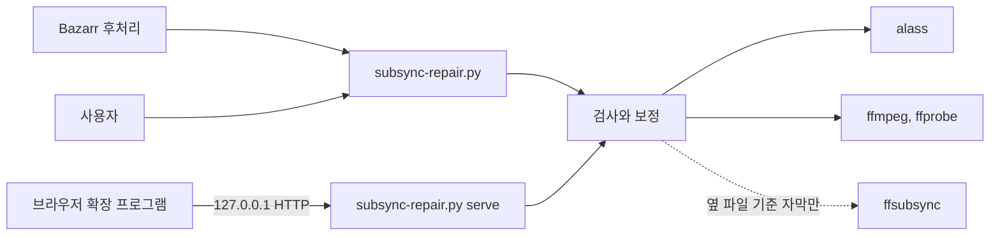

# subsync-repair

[English](README.md) | 한국어

싱크가 구간마다 다르게 어긋난 자막을 보정합니다. 오프닝 앞과 뒤의 어긋남이 다르거나, 광고 시간이 끼어 있거나, 영상의 판본이
다른 경우입니다. 이런 자막은 전체를 한 번 미는 것으로는 고칠 수 없습니다. subsync-repair는 [alass](https://github.com/kaegi/alass)로
자막을 다른 언어의 기준 자막에 맞추고, 그 보정이 믿을 만한지 검사한 뒤에만, 원본을 백업하고 씁니다.

자막이 영상 옆에 있는 미디어 라이브러리(Jellyfin, Plex, Bazarr)를 위해 만들었고, 20개 언어 중 어느 것에나 쓸 수 있습니다.



## 동작 방식

1. **기준 자막 찾기**: 자막과 다른 언어로 된, 영상 안의 전체 대사 텍스트 트랙을 쓰고, 없으면 영상 옆의 자막 파일을 씁니다.
   옆 파일은 그 자체로 어긋나 있을 수 있으므로 [ffsubsync](https://github.com/smacke/ffsubsync)가 오디오와 맞는다고 확인한
   뒤에만 씁니다.
2. **맞추기**: alass로 자막을 기준 자막에 맞추고, 각 큐의 시작 시각을 보정 전후로 비교합니다. 이동량은 구간을 이룹니다. 구간은
   거의 같은 만큼 움직인 연속된 큐들입니다.
3. **판단**: 0.6초보다 많이 움직이는 큐가 없으면 싱크가 맞는 자막입니다. 너무 크거나 들쭉날쭉한 보정은 거부합니다(아래 참고).
4. **쓰기**: 백업 후 그 자리에 쓰거나(`--run`), 새 파일에 씁니다(`--json --out`, 또는 서버의 `fix` 작업).

지원하는 파일은 `.srt`, `.smi`(SAMI), `.ass` / `.ssa`이고, 영상 옆에 `<영상>.<언어>[.<플래그>...].<확장자>` 이름으로 있어야
합니다. 예: `Movie.ko.srt`, `Show S01E01.en.sdh.srt`. forced, signs, songs, commentary 트랙은 건드리지 않습니다.

- `.smi`는 `.srt`로 쓰고 `.smi`는 백업 폴더로 옮깁니다. 여러 언어가 든 `.smi`라면 다른 언어마다 `<영상>.<언어>.srt`를 따로
  만듭니다. 그중 하나라도 만들 수 없으면 `.smi`는 그대로 남습니다.
- `.ass`는 대사 이벤트를 옮겨서 보정합니다. 같은 언어의 `.srt`가 타이밍을 공유하면 `.srt`를 보정하고 `.ass`도 함께 옮깁니다.

### 보정을 막는 조건

영상 안의 트랙은 큐가 50개 이상일 때 기준 자막이 됩니다. 영상 옆의 파일은 영상 끝을 60초보다 많이 넘지 않고, ffsubsync가
찾은 오프셋이 1초 이하, 배율 차이가 0.1 % 이내이며 오디오와 맞을 때 기준 자막이 됩니다. 쓸 만한 기준 자막이 없으면 그 자막은
건너뜁니다.

그다음, 아무것도 쓰기 전에 보정을 검사합니다(상수는 `subsync_repair/engine/policy.py`에 있습니다):

| 검사 | 거부하는 경우 |
|---|---|
| 큐가 너무 적음 | 자막의 큐가 20개 미만 |
| 텍스트 | alass가 큐의 텍스트를 바꿈(공백 차이 제외) |
| 크기 | 180초보다 많이 움직이는 큐가 있음 |
| 구간이 많음 | 구간이 6개보다 많고 5초보다 많이 움직이는 큐가 있음 |
| 불안정한 시작 | 첫 큐부터 30초 안에 시작하는 구간이 3개 이상. 단, 한 방향으로 1초 이하씩 변하는 경우(프레임 레이트 차이)는 제외 |
| 다른 에피소드나 판본 | 30초보다 많이 움직이는 큐가 있고, 큐의 절반을 담은 구간이 없으며, 이동량이 꾸준히 늘지 않음(`mismatch`로 보고) |
| 큐 순서 | 보정이 순서가 뒤바뀐 큐를 늘림 |
| 0초 | 보정이 0:00으로 밀려나는 큐를 3개보다 많이 늘림 |
| 겹친 큐 | 보정이 앞 큐와 시작 시각이 같은 큐를 2개 이상 늘림 |
| 영상의 끝 | 보정한 자막이 영상 끝을 30초보다 많이 넘김 |

원본에 이미 있던 문제(순서가 뒤바뀐 큐, 0:00의 큐, 겹친 큐)는 보정 탓으로 보지 않습니다. 쓰기는 원자적이고, 검사하는 동안
바뀐 파일은 건너뛰며, 백업은 전체 경로를 유지하고 절대 덮어쓰지 않습니다.

## 요구 사항

- Python 3.10 이상. 표준 라이브러리만 씁니다.
- `ffmpeg`, `ffprobe`.
- [alass](https://github.com/kaegi/alass)의 `alass-cli`: `cargo install alass-cli`, 또는 릴리스 바이너리를 받아
  `tools.alass`에 지정.
- 선택: [ffsubsync](https://github.com/smacke/ffsubsync)가 설치된 Python 인터프리터. 없으면 영상 옆의 자막 파일은 기준 자막으로
  쓰지 않고, 영상 안의 트랙만 씁니다.

## 설정

```
git clone https://github.com/wonjoonSeol-WS/subsync-repair.git
cd subsync-repair
cp config.example.json config.json
```

`config.json`에서 적어도 `target_language`와 `libraries`를 고칩니다. 이 도구는 라이브러리 폴더 안에서만 읽고 씁니다.

| 키 | 기본값 | 뜻 |
|---|---|---|
| `target_language` | 필수 | 라이브러리 검사가 보정하는 자막의 언어: `en`, `ja`, `ko`, `zh`, `es`, `fr`, `de`, `it`, `pt`, `ru`, `vi`, `th`, `id`, `ar`, `hi`, `tr`, `pl`, `nl`, `sv`, `uk` |
| `libraries` | 필수 | 절대 경로로 쓴 폴더 목록 |
| `skip_dirs` | 없음 | 라이브러리 검사에서 뺄 폴더 이름(대소문자 무관) |
| `embedded_reference_languages` | `["en", "*"]` | 기준 자막이 될 수 있는 영상 안 트랙의 언어, 좋은 순서대로. `"*"`는 그 밖의 모든 언어 |
| `reference_languages` | `["en", "*"]` | 영상 옆 자막 파일에 대한 같은 설정 |
| `tools.alass`, `tools.ffmpeg`, `tools.ffprobe` | `alass-cli`, `ffmpeg`, `ffprobe` | `PATH`에 있는 프로그램 이름, 또는 경로(상대 경로는 `config.json`이 있는 폴더 기준) |
| `tools.ffsubsync_python` | 없음 | ffsubsync를 import할 수 있는 인터프리터 |
| `tools.ffsubsync_libs` | 없음 | 그 인터프리터의 import 경로에 더할 폴더 |
| `tools.data_dir` | 아래 참고 | 백업과 상태를 두는 곳 |
| `sync.port` | `8778` | 싱크 서버의 포트 |
| `sync.extension_ids` | 없음 | 싱크 서버가 응답할 브라우저 확장 프로그램: Chrome 확장 ID, Firefox 확장 UUID, 또는 아무 확장이나 허용하는 `"*"` |

자막은 절대 자기 자신의 기준이 되지 않습니다. 두 기준 언어 목록 모두에서 자막 자신의 언어는 건너뜁니다.

데이터 폴더에는 백업(`backup/repair-<시각>/`), 이전 판정의 캐시, 두 실행이 겹치지 않게 하는 잠금 파일, 훅 대기열, 서버가 만든
사본의 기록이 있습니다. 기본 위치는 Windows에서 `%PROGRAMDATA%\subsync-repair`, macOS에서
`~/Library/Application Support/subsync-repair`, 그 밖에서는 `$XDG_DATA_HOME/subsync-repair`(또는
`~/.local/share/subsync-repair`)입니다. 컨테이너에서는 `tools.data_dir`를 마운트한 볼륨의 폴더로 지정하세요. Windows에서 새로
만든 데이터 폴더는 서비스 계정과 사용자가 함께 쓸 수 있도록 모든 로컬 사용자에게 수정 권한을 주고, 관리자가 아닌 다른 계정이
소유한 기존 폴더는 거부합니다.

## 사용법

```
python subsync-repair.py                          라이브러리 전체 드라이런(target_language 자막)
python subsync-repair.py --run                    그 자리에서 보정. 모든 원본은 먼저 백업
python subsync-repair.py [--run] SUBTITLE ...     이 파일들만, 언어 무관, 파일마다 한 줄 출력
python subsync-repair.py --json SUBTITLE          자막 하나를 검사해 JSON으로 출력. 아무것도 쓰지 않음
python subsync-repair.py --json --out NEW.srt SUBTITLE    위와 같고, 보정한 자막을 새 파일에 씀
python subsync-repair.py --no-cache ...           이전 실행이 이미 판정한 것도 다시 검사
python subsync-repair.py serve [--port PORT]      브라우저 확장 프로그램용 싱크 서버
```

저장소 폴더에서는 `python -m subsync_repair`로도 똑같이 실행할 수 있습니다.

모든 결과에는 상태가 있습니다: `ok`, `would-fix`, `fixed`, `skip`, `mismatch`, `error`. 라이브러리 검사는 살펴볼 것과 요약
한 줄만 출력하고, 명령줄에 준 파일은 언제나 `<상태>: <경로>  <설명>` 한 줄을 받습니다. 검사 중 하나라도 `error`로 끝나면
종료 코드는 1입니다.

판정은 자막, 그 영상, 그 영상의 다른 자막, 또는 기준 자막 설정, 도구, 이 프로그램이 바뀔 때까지 캐시됩니다. `error`는 다음
실행에서 다시 시도합니다. 단, 되돌리지 못한 쓰기 실패는 예외입니다.

### Bazarr 후처리 훅으로 쓰기

Bazarr의 Settings > Subtitles > Processing > Custom Post-Processing에서 명령을 다음처럼 지정합니다:

```
python /path/to/subsync-repair.py --hook --log /path/to/subsync-repair.log "{{subtitles}}"
```

`--hook`은 `--run`을 포함합니다. 내려받은 자막마다 검사하고 그 자리에서 보정하며, 결과를 로그에 덧붙입니다. 다른 실행이 잠금을 30초보다 오래 잡고 있으면
Bazarr의 다운로드 작업을 붙잡지 않도록 그 파일을 대기열에 넣어 그 실행이 처리하게 합니다. 훅은 `.smi`를 변환하지 않습니다.
라이브러리 검사나 수동 실행이 변환합니다. 설정 파일이 `subsync-repair.py` 옆에 없으면 `--config /path/to/config.json`을
덧붙입니다.

### 싱크 서버

`python subsync-repair.py serve`는 브라우저 확장 프로그램의 "싱크 보정" 버튼을 위한 작은 HTTP API를 `127.0.0.1`에서 엽니다.

| 요청 | 응답 |
|---|---|
| `GET /health` | `{"ok", "alass", "ffmpeg", "ffprobe", "worker_alive"}` |
| `POST /jobs`, 본문 `{"action": "measure" 또는 "fix", "path": "<자막의 절대 경로>"}` | `202 {"id"}` |
| `GET /jobs/<id>` | `{"state": "queued", "running" 또는 "done", "action", "path", "result"}` |

`fix`는 보정한 자막을 원본 옆에 `<자막 이름>.synced.srt`로 쓰고 원본은 건드리지 않습니다. 덮어쓸 수 있는 것은 서버가 직접 쓴
사본뿐입니다. 작업은 한 번에 하나씩 실행하고, 대기와 실행 중인 작업은 최대 50개이며, 그보다 많으면 429로 거부합니다.

서버는 `127.0.0.1`에서만 듣고 루프백 `Host`에만 응답합니다. 요청에는 `Origin`이 없거나(로컬 프로그램), `sync.extension_ids`에
있는 확장 프로그램의 origin이 있어야 합니다. 비밀번호는 없습니다: 이 컴퓨터에서 실행되는 어떤 프로그램이든 호출할 수 있습니다.

## 개발

```
python -m unittest discover -s tests
```

`ffmpeg`나 `alass-cli`가 필요한 테스트는 그 프로그램이 없으면 건너뜁니다. GitHub Actions가 Windows, Linux, macOS에서
Python 3.10과 3.13으로 테스트를 실행합니다.

| 폴더 | 들어 있는 것 |
|---|---|
| `subsync_repair/` | 명령(`cli.py`), 설정(`config.py`), 출력 줄(`report.py`), 싱크 서버(`server.py`) |
| `subsync_repair/engine/` | 기준 자막 찾기, alass 보정 판단(`policy.py`), 보정 쓰기, 판정 캐시 |
| `subsync_repair/formats/` | SRT, ASS/SSA, SAMI, 자막 파일 이름, 언어, 텍스트 디코딩 |
| `subsync_repair/external/` | ffmpeg와 ffprobe, alass, ffsubsync(`ffsubsync_check.py`는 ffsubsync가 설치된 인터프리터에서 실행) |
| `subsync_repair/storage/` | 안전한 파일 쓰기와 잠금, 데이터 폴더, 훅 대기열, 라이브러리 폴더 |
| `tests/` | 테스트. `support.py`에 공용 가짜 객체와 픽스처가 있음 |

## 라이선스

[MIT](LICENSE)
