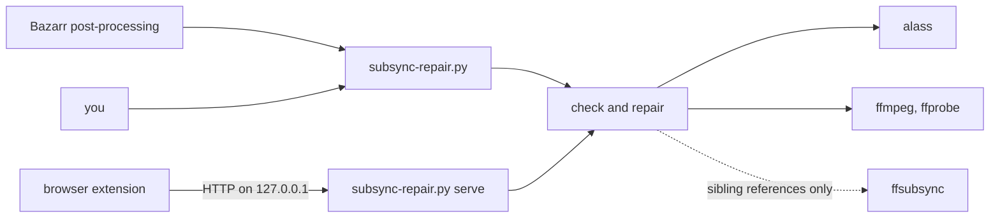

# subsync-repair

English | [한국어](README.ko.md)

Repairs subtitles whose timing drifts in pieces: one offset before the opening and another after it, a commercial
break, or a different cut of the video. A single global shift cannot fix those. subsync-repair aligns the subtitle with
[alass](https://github.com/kaegi/alass) to a reference in another language, checks that the correction is believable,
and only then writes it, after backing up the original.

It is made for a media library whose subtitles sit next to the videos (Jellyfin, Plex, Bazarr), in any of 20 languages.



## How it works

1. **Find a reference** in another language than the subtitle: a full dialogue text track inside the video, or else a
   subtitle file next to the video. A file next to the video can drift itself, so it is used only after
   [ffsubsync](https://github.com/smacke/ffsubsync) finds it in sync with the audio.
2. **Align** the subtitle to the reference with alass and compare every cue's start time before and after. The shifts
   form pieces: runs of cues that moved by about the same amount.
3. **Judge** the correction. No cue moving more than 0.6 s means the subtitle is in sync. A correction that is too large
   or too erratic is refused (see below).
4. **Write** it: in place after a backup (`--run`), or to a new file (`--json --out`, or the server's `fix` job).

Supported files are `.srt`, `.smi` (SAMI) and `.ass` / `.ssa`, named `<video>.<language>[.<flag>...].<ext>` next to
their video, such as `Movie.ko.srt` or `Show S01E01.en.sdh.srt`. Forced, signs, songs and commentary tracks are left
alone.

- A `.smi` is written as an `.srt` and the `.smi` goes to the backup folder. Each other language a multi-language `.smi`
  holds becomes its own `<video>.<language>.srt`; when one of them cannot be made, the `.smi` stays.
- An `.ass` is repaired by shifting its dialogue events. When an `.srt` in the same language shares its timing, the
  `.srt` is repaired and the `.ass` is shifted along with it.

### What stops a repair

A track inside the video serves as the reference when it has at least 50 cues. A file next to the video serves when it
runs no more than 60 s past the end of the video and ffsubsync finds an offset of at most 1 s, a scale within 0.1 % and
a match with the audio. Without a usable reference the subtitle is skipped.

The correction is then checked before anything is written (the constants are in `subsync_repair/engine/policy.py`):

| Check | Refused when |
|---|---|
| Too few cues | the subtitle has fewer than 20 cues |
| Text | alass changed the text of a cue (whitespace aside) |
| Size | some cue would move more than 180 s |
| Many pieces | more than 6 pieces and some cue would move more than 5 s |
| Unstable start | 3 or more pieces start within 30 s of the first cue, unless they are steps of at most 1 s in one direction (a frame rate drift) |
| Another episode or cut | some cue would move more than 30 s, no piece holds half of the cues and the shift does not grow steadily (reported as `mismatch`) |
| Cue order | the fix adds cues out of order |
| Time zero | the fix pushes more than 3 more cues to 0:00 |
| Stacked cues | the fix adds 2 or more cues that share a start time with an earlier cue |
| End of the video | the corrected subtitle runs more than 30 s past the end of the video |

What the original already had (cues out of order, at 0:00 or stacked) is not blamed on the fix. Writes are atomic, a
file that changed while it was checked is skipped, and backups keep the full path and are never overwritten.

## Requirements

- Python 3.10 or newer. Only the standard library is used.
- `ffmpeg` and `ffprobe`.
- `alass-cli` from [alass](https://github.com/kaegi/alass): `cargo install alass-cli`, or a release binary that
  `tools.alass` points to.
- Optional: a Python interpreter with [ffsubsync](https://github.com/smacke/ffsubsync) installed. Without it, subtitle
  files next to the video are never used as references, only tracks inside the video.

## Setup

```
git clone https://github.com/wonjoonSeol-WS/subsync-repair.git
cd subsync-repair
cp config.example.json config.json
```

Edit `config.json`: at least `target_language` and `libraries`. The tool reads and writes only inside the library
folders.

| Key | Default | Meaning |
|---|---|---|
| `target_language` | required | Language of the subtitles a library scan repairs: `en`, `ja`, `ko`, `zh`, `es`, `fr`, `de`, `it`, `pt`, `ru`, `vi`, `th`, `id`, `ar`, `hi`, `tr`, `pl`, `nl`, `sv` or `uk` |
| `libraries` | required | Absolute folder paths |
| `skip_dirs` | none | Folder names (any letter case) a library scan leaves out |
| `embedded_reference_languages` | `["en", "*"]` | Languages of a track inside the video that may be the reference, best first; `"*"` is any other language |
| `reference_languages` | `["en", "*"]` | The same for a subtitle file next to the video |
| `tools.alass`, `tools.ffmpeg`, `tools.ffprobe` | `alass-cli`, `ffmpeg`, `ffprobe` | A program on `PATH`, or a path (a relative path starts at the folder of `config.json`) |
| `tools.ffsubsync_python` | none | An interpreter that can import ffsubsync |
| `tools.ffsubsync_libs` | none | Folders added to that interpreter's import path |
| `tools.data_dir` | see below | Where backups and state are kept |
| `sync.port` | `8778` | Port of the sync server |
| `sync.extension_ids` | none | Browser extensions the sync server answers: Chrome extension ids, Firefox extension UUIDs, or `"*"` for any |

A subtitle is never its own reference: its own language is skipped in both reference lists.

The data folder holds the backups (`backup/repair-<time>/`), the cache of earlier verdicts, the lock that keeps two
runs apart, the hook queue and the server's record of its copies. It defaults to `%PROGRAMDATA%\subsync-repair` on
Windows, `~/Library/Application Support/subsync-repair` on macOS and `$XDG_DATA_HOME/subsync-repair` (or
`~/.local/share/subsync-repair`) elsewhere. In a container, set `tools.data_dir` to a folder on a mounted volume. On
Windows a new data folder lets every local user modify what it holds, so that a service account and you can share it,
and an existing one owned by another account that is no administrator is refused.

## Usage

```
python subsync-repair.py                          dry run over the libraries (subtitles in target_language)
python subsync-repair.py --run                    repair them in place; every original is backed up first
python subsync-repair.py [--run] SUBTITLE ...     only these files, in any language, one line of output each
python subsync-repair.py --json SUBTITLE          check one subtitle and print the result as JSON; nothing is written
python subsync-repair.py --json --out NEW.srt SUBTITLE    the same, and write the corrected subtitle to a new file
python subsync-repair.py --no-cache ...           check again what an earlier run already judged
python subsync-repair.py serve [--port PORT]      the sync server for a browser extension
```

`python -m subsync_repair` does the same from the repository folder.

Every result has a status: `ok`, `would-fix`, `fixed`, `skip`, `mismatch` or `error`. A library scan prints only what
needs attention and a summary line; a file named on the command line always gets one line,
`<status>: <path>  <note>`. The exit status is 1 when any check ended in `error`.

A verdict is cached until the subtitle, its video or the other subtitles of that video change, or the reference
settings, the tools or this program do. An `error` is tried again on the next run, unless it is a failed write that
could not be undone.

### As a Bazarr post-processing hook

In Bazarr, under Settings > Subtitles > Processing > Custom Post-Processing, set the command to:

```
python /path/to/subsync-repair.py --hook --log /path/to/subsync-repair.log "{{subtitles}}"
```

`--hook` implies `--run`: each downloaded subtitle is checked and repaired in place, and the outcome is appended to the
log. When another run holds the lock for more than 30 s, the file is queued for that run instead, so that Bazarr's
download job is not held up. The hook never converts a `.smi`; a library scan or a manual run does. Add
`--config /path/to/config.json` when the settings are not next to `subsync-repair.py`.

### The sync server

`python subsync-repair.py serve` starts a small HTTP API on `127.0.0.1` for a browser extension's "Fix sync" button.

| Request | Answer |
|---|---|
| `GET /health` | `{"ok", "alass", "ffmpeg", "ffprobe", "worker_alive"}` |
| `POST /jobs` with `{"action": "measure" or "fix", "path": "<absolute subtitle path>"}` | `202 {"id"}` |
| `GET /jobs/<id>` | `{"state": "queued", "running" or "done", "action", "path", "result"}` |

`fix` writes the corrected subtitle next to the original as `<subtitle name>.synced.srt` and never touches the original.
It may replace only a copy it wrote itself. Jobs run one at a time, at most 50 wait or run, and more are refused with
429.

The server listens on `127.0.0.1` only and answers a loopback `Host` only. Requests must carry no `Origin` (a local
program) or the origin of an extension listed in `sync.extension_ids`. It has no password: anything running on this
machine can call it.

## Development

```
python -m unittest discover -s tests
```

Tests that need `ffmpeg` or `alass-cli` skip themselves when the program is missing. GitHub Actions runs the suite on
Windows, Linux and macOS with Python 3.10 and 3.13.

| Folder | What it holds |
|---|---|
| `subsync_repair/` | The command (`cli.py`), the settings (`config.py`), the output lines (`report.py`) and the sync server (`server.py`) |
| `subsync_repair/engine/` | Finding a reference, judging alass's correction (`policy.py`), writing it, and the verdict cache |
| `subsync_repair/formats/` | SRT, ASS/SSA and SAMI, subtitle file names, languages and text decoding |
| `subsync_repair/external/` | ffmpeg and ffprobe, alass, and ffsubsync (`ffsubsync_check.py` runs in ffsubsync's own interpreter) |
| `subsync_repair/storage/` | Crash-safe writes and the lock, the data folder, the hook queue and the library folders |
| `tests/` | The test suite; `support.py` holds the shared fakes and fixtures |

## License

[MIT](LICENSE)
